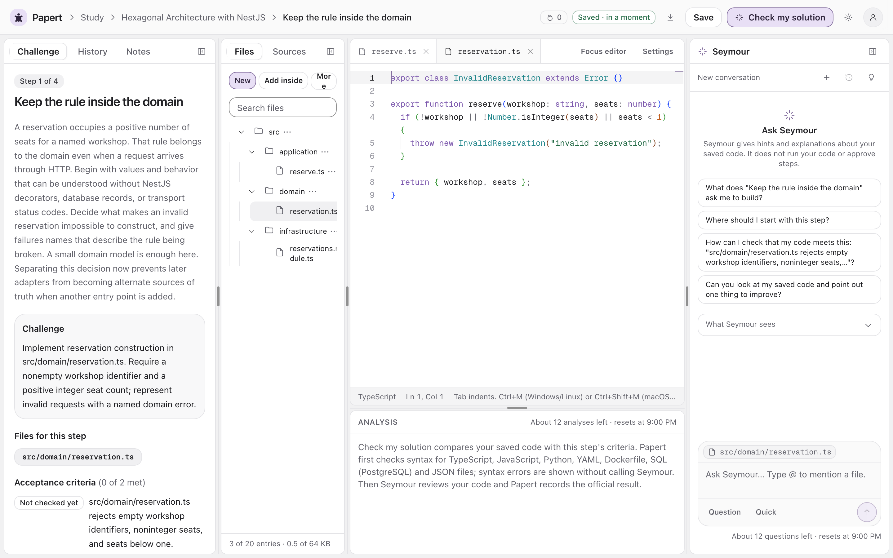
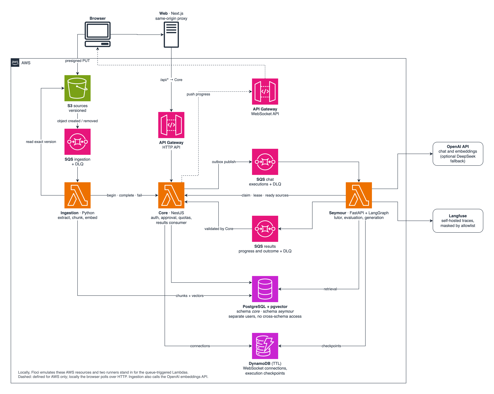

# Papert

[](https://github.com/cauasturaro/Papert/actions/workflows/ci.yml)
[](https://github.com/cauasturaro/Papert/actions/workflows/security.yml)
[](LICENSE)

**English** · [Português](README.pt-BR.md)

Papert teaches software development by building. A learner picks a roadmap, works through each
step in a multi-file editor in the browser, and asks Seymour, an AI tutor, for hints grounded
in the saved code and in the learner's own uploaded documents. Seymour evaluates each attempt
against the step's criteria, but only the Core API decides whether the step is approved. The
model proposes; it never writes state.



## Quick start

Requirements: Docker with Compose, Make, OpenSSL and Python 3.

```sh
git clone https://github.com/cauasturaro/Papert.git
cd Papert
make demo
```

Open http://localhost:3000, create an account and start a roadmap from the community catalog.

Demo mode runs the whole application on a deterministic offline model, so it needs no API
key. Its answers are labelled as demo output. The first build downloads and builds several
images and takes a while.

### With a real model

```sh
make up        # generates .env and provisions the local infrastructure
```

Set `OPENAI_API_KEY` in `.env`, then start the applications:

```sh
make up-apps
```

### Commands

| Command | Result |
| --- | --- |
| `make demo` | Starts everything on the offline model |
| `make up-all` | Starts everything on the real model |
| `make down-all` | Stops the stack and keeps the volumes |
| `make smoke-apps` | Checks the Core and Seymour health endpoints |
| `make logs` | Shows the emulator output |
| `make e2e` | Runs the browser tests on a separate, disposable stack |

| Service | URL |
| --- | --- |
| Web | http://localhost:3000 |
| Core | http://localhost:3001 |
| Seymour | http://localhost:3002 |
| Langfuse | http://localhost:3003 (credentials in `.env.langfuse`) |

Every port binds to `127.0.0.1`. Free ports 3000–3003, 4566 and 7001 before starting.

## Architecture



Core is the system of record and the only writer of learner progress. Seymour and Ingestion
are queue-driven workers that call the model and report back, and Core validates what they
report before it changes any state.

| Folder | Stack | Role |
| --- | --- | --- |
| [`apps/web`](apps/web/README.md) | Next.js, React, Monaco | Study workspace, tutor chat and catalog |
| [`apps/core`](apps/core/README.md) | NestJS, Prisma, PostgreSQL | Accounts, workspaces, approval, execution admission and quotas |
| [`apps/seymour`](apps/seymour/README.md) | FastAPI, LangGraph, OpenAI | Tutor, attempt evaluation, roadmap generation and retrieval |
| [`apps/ingestion`](apps/ingestion/README.md) | Python, pgvector | Document extraction, chunking and embeddings |
| [`infra`](infra/README.md) | Docker Compose, Floci, Serverless | Local AWS emulation and the AWS stack definitions |
| [`contracts`](contracts/README.md) | JSON fixtures | Message examples that producers and consumers are both tested against |

## Documentation

| Document | Covers |
| --- | --- |
| [Architecture](docs/architecture.md) | Components, request flows and design highlights |
| [Decision records](docs/adr/README.md) | Six decisions with their rejected alternatives and trade-offs |
| [Testing](docs/testing.md) | Test levels, the offline model, AI quality gates and known gaps |
| [Threat model](docs/security/threat-model.md) | Assets, trust boundaries, abuse controls and known limitations |
| [AWS deployment](docs/deployment.md) | What the stacks cover, prerequisites and release order |
| [Operations](docs/operations.md) | Limits, monitoring, retention, recovery and maintenance |

## Status

Papert runs locally, with AWS emulated by Floci. The AWS
stacks are defined and validated statically but have never been deployed.

Not implemented: password recovery, email confirmation, MFA and execution of learner code.

## License

Copyright (C) 2026 cauasturaro

Papert is licensed under the [GNU Affero General Public License v3.0](LICENSE). If you run a
modified version as a network service, you must make its source code available to its users.
