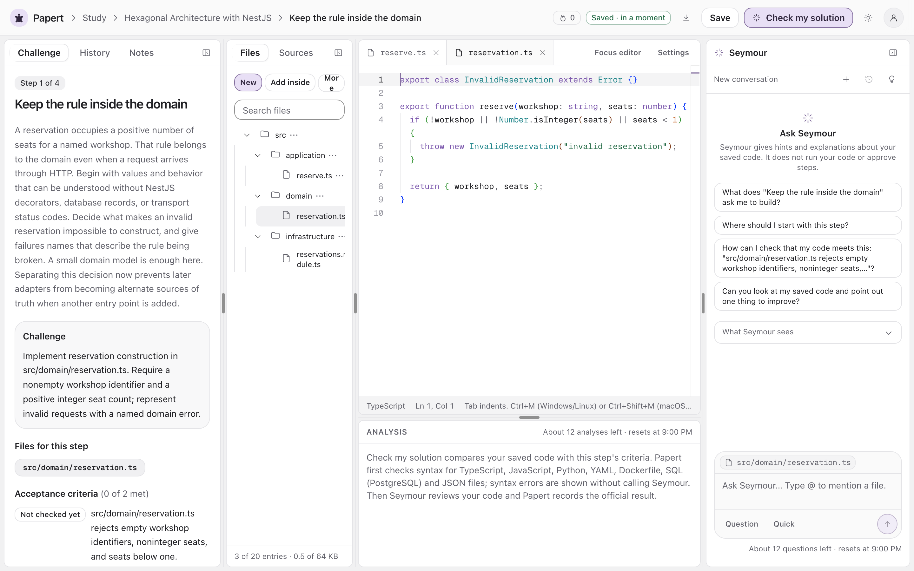
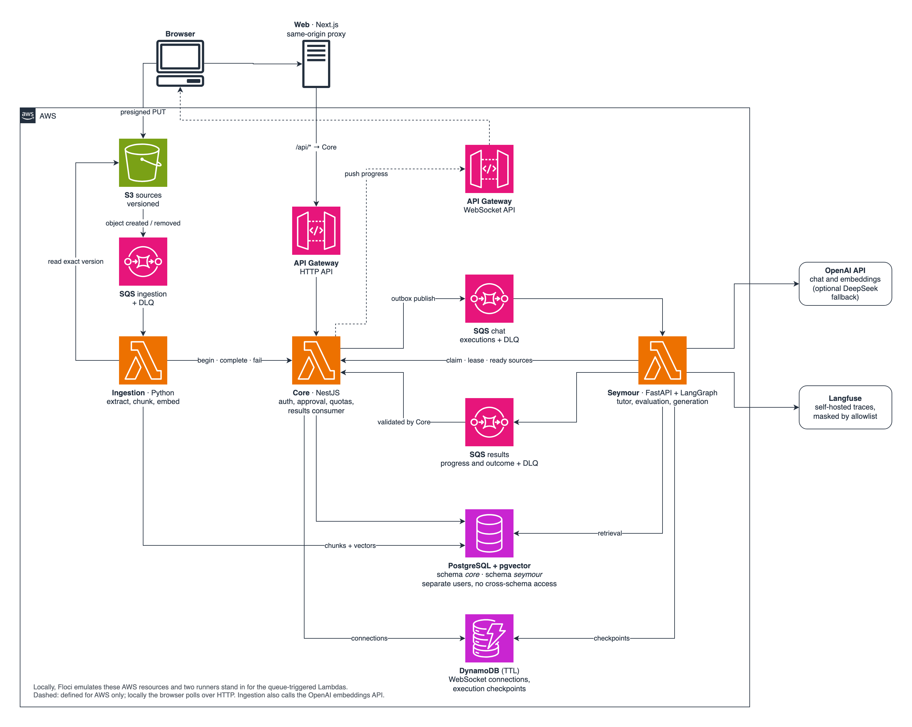

# Papert

[](https://github.com/cauasturaro/Papert/actions/workflows/ci.yml)
[](https://github.com/cauasturaro/Papert/actions/workflows/security.yml)
[](LICENSE)

[English](README.md) · **Português**

O Papert ensina desenvolvimento de software na prática. A pessoa escolhe um roadmap, resolve
cada etapa em um editor de múltiplos arquivos no navegador e pede dicas ao Seymour, um tutor
de IA que se baseia no código salvo e nos documentos que ela mesma enviou. O Seymour avalia
cada tentativa segundo os critérios da etapa, mas só a API Core decide se a etapa é aprovada.
O modelo propõe; ele nunca grava estado.



## Início rápido

Requisitos: Docker com Compose, Make, OpenSSL e Python 3.

```sh
git clone https://github.com/cauasturaro/Papert.git
cd Papert
make demo
```

Abra http://localhost:3000, crie uma conta e inicie um roadmap do catálogo da comunidade.

O modo demo roda a aplicação inteira com um modelo offline determinístico, então não precisa
de chave de API. As respostas dele são identificadas como saída de demonstração. O primeiro
build baixa e constrói várias imagens e demora um pouco.

### Com um modelo real

```sh
make up        # gera o .env e provisiona a infraestrutura local
```

Defina `OPENAI_API_KEY` no `.env` e depois suba as aplicações:

```sh
make up-apps
```

### Comandos

| Comando | Resultado |
| --- | --- |
| `make demo` | Sobe tudo com o modelo offline |
| `make up-all` | Sobe tudo com o modelo real |
| `make down-all` | Para a stack e mantém os volumes |
| `make smoke-apps` | Verifica os endpoints de saúde do Core e do Seymour |
| `make logs` | Mostra a saída do emulador |
| `make e2e` | Roda os testes de navegador em uma stack separada e descartável |

| Serviço | URL |
| --- | --- |
| Web | http://localhost:3000 |
| Core | http://localhost:3001 |
| Seymour | http://localhost:3002 |
| Langfuse | http://localhost:3003 (credenciais em `.env.langfuse`) |

Todas as portas escutam em `127.0.0.1`. Libere as portas 3000–3003, 4566 e 7001 antes de subir.

## Arquitetura



O Core é o sistema de registro e o único que grava o progresso de quem estuda. Seymour e
Ingestion são workers acionados por filas que chamam o modelo e reportam o resultado, e o Core
valida o que eles reportam antes de alterar qualquer estado.

| Pasta | Stack | Papel |
| --- | --- | --- |
| [`apps/web`](apps/web/README.pt-BR.md) | Next.js, React, Monaco | Workspace de estudo, chat com o tutor e catálogo |
| [`apps/core`](apps/core/README.pt-BR.md) | NestJS, Prisma, PostgreSQL | Contas, workspaces, aprovação, admissão de execuções e cotas |
| [`apps/seymour`](apps/seymour/README.pt-BR.md) | FastAPI, LangGraph, OpenAI | Tutor, avaliação de tentativas, geração de roadmaps e busca |
| [`apps/ingestion`](apps/ingestion/README.pt-BR.md) | Python, pgvector | Extração de documentos, chunking e embeddings |
| [`infra`](infra/README.pt-BR.md) | Docker Compose, Floci, Serverless | Emulação local da AWS e as definições das stacks AWS |
| [`contracts`](contracts/README.pt-BR.md) | Fixtures JSON | Exemplos de mensagens contra os quais produtores e consumidores são testados |

## Documentação

Os documentos abaixo estão em inglês.

| Documento | Conteúdo |
| --- | --- |
| [Arquitetura](docs/architecture.md) | Componentes, fluxos de requisição e destaques do design |
| [Registros de decisão](docs/adr/README.md) | Seis decisões com as alternativas rejeitadas e os trade-offs |
| [Testes](docs/testing.md) | Níveis de teste, o modelo offline, critérios de qualidade de IA e lacunas conhecidas |
| [Modelo de ameaças](docs/security/threat-model.md) | Ativos, fronteiras de confiança, controles de abuso e limitações conhecidas |
| [Deploy na AWS](docs/deployment.md) | O que as stacks cobrem, pré-requisitos e ordem de release |
| [Operação](docs/operations.md) | Limites, monitoramento, retenção, recuperação e manutenção |

## Status

O Papert roda localmente, com a AWS emulada pelo Floci. As stacks AWS estão definidas e
validadas estaticamente, mas nunca foram implantadas.

Não implementado: recuperação de senha, confirmação de e-mail, MFA e execução do código de
quem estuda.

## Licença

Copyright (C) 2026 cauasturaro

O Papert é licenciado sob a [GNU Affero General Public License v3.0](LICENSE). Se você rodar
uma versão modificada como serviço de rede, deve disponibilizar o código-fonte a quem usa esse
serviço.
