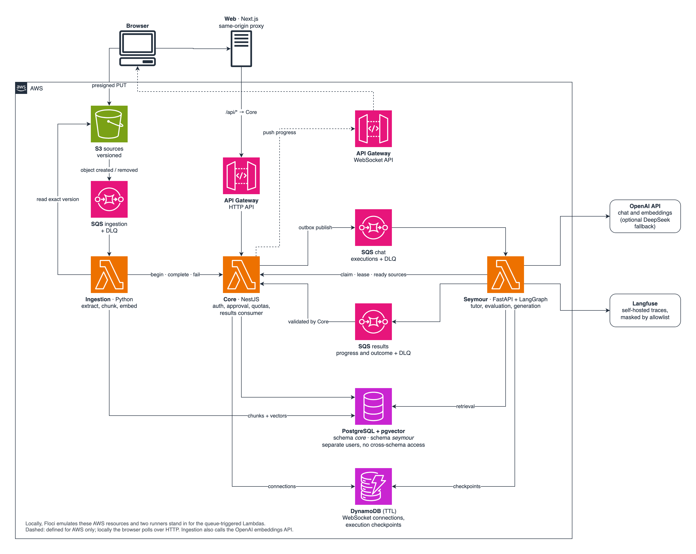
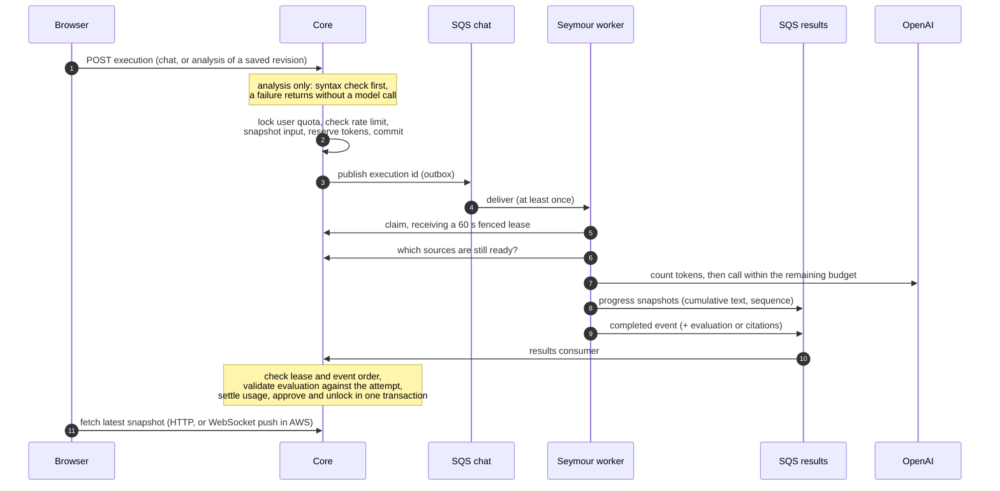
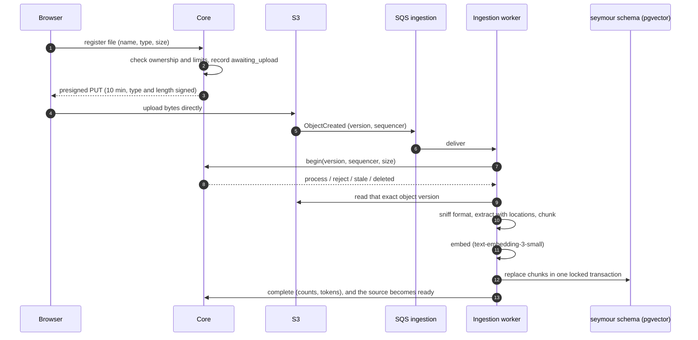

# Architecture

Papert is four services and a set of AWS resources. Locally, Floci
emulates the AWS resources and Docker Compose runs everything. The AWS deployment is
described in `serverless.yml` files and CloudFormation templates but has not been deployed.

The diagram source is [`images/architecture.drawio`](images/architecture.drawio).

Two rules shape the picture:

- **Core is the only writer of learner state.** Seymour and Ingestion never touch Core's
  schema. They ask Core for permission through control functions that have no HTTP route, and
  report outcomes that Core validates before acting.
- **Model work is asynchronous.** A request returns as soon as Core has admitted it and
  reserved its tokens. The answer travels back through a queue, so a cold start, a throttled
  provider or a crashed worker delays an answer without losing it.

## Resources

| Resource | Used for | Notes |
| --- | --- | --- |
| SQS `papert-chat` | Admitted executions, from Core to Seymour | Dead-letter queue; delivery is at least once |
| SQS `papert-results` | Progress snapshots and outcomes, from Seymour to Core | Dead-letter queue; Core checks lease and event order |
| SQS `papert-ingestion` | S3 object created and removed events | Dead-letter queue; replayed with `make ingestion-redrive` |
| S3 `papert-sources` | Uploaded documents | Versioned; the worker reads the exact version Core approved |
| PostgreSQL + pgvector | Schema `core` (application state) and schema `seymour` (chunks and vectors) | One instance, two users, no cross-schema access |
| DynamoDB `papert-sessions` | WebSocket connection mappings (Core) and execution checkpoints (Seymour) | Disposable; items expire through TTL |
| API Gateway | HTTP API in front of Core; WebSocket API for progress push | The WebSocket path exists only in the AWS definition |
| OpenAI | Chat completions and embeddings | Optional DeepSeek fallback for chat |
| Langfuse | Traces, prompt versions and feedback scores | Self-hosted; free text is masked by an allowlist |

## Responsibilities

| Component | Owns | Never does |
| --- | --- | --- |
| **Web** | UI, the Monaco workspace with autosave and conflict detection, a same-origin proxy to Core | Store tokens in the browser; talk to Seymour directly |
| **Core** | Accounts and sessions, roadmaps and workspaces, attempts and approval, execution admission, quotas, sources state, memory, community catalog, feedback, streaks | Call a model; read Seymour's schema |
| **Seymour** | Tutor, attempt evaluation and roadmap generation as LangGraph workflows; retrieval over pgvector; tracing | Write progression; read Core's schema; execute learner code |
| **Ingestion** | Extraction, chunking and embeddings for uploaded documents | Decide whether a document may be processed (it asks Core) |

Core and Seymour connect to the same PostgreSQL instance as different users, each limited to
its own schema. `make check-isolation` checks that neither can read the other's schema.

Each backend module uses `domain/` (rules and ports), `application/` (use cases) and
`infrastructure/` (adapters and wiring). See
[ADR 0004](adr/0004-hexagonal-boundaries-and-accepted-exceptions.md).

Core modules: `auth`, `study`, `analysis` (syntax filter), `executions`, `sources`, `memory`,
`community`, `engagement`, `feedback`, `health`.
Seymour modules: `tutor`, `evaluation`, `roadmap`, `recommendation`, `retrieval`,
`executions`, `shared` (model ports, fallback policy, prompt versions, tracing).

## Flow 1: tutor chat and attempt analysis

Key properties: duplicates are harmless (leases, event indexes, once-only settlement), spend
is capped before the call, and the model never writes state. Details in
[ADR 0001](adr/0001-core-owns-approval-and-progression.md) and
[ADR 0002](adr/0002-async-execution-pipeline.md).

## Flow 2: source upload and ingestion

Deleting a source marks it deleted in Core first, then removes the S3 versions. The removal
events purge the vectors and leave a tombstone. Retrieval is filtered by the workspace and
by the sources Core still reports as ready, so a deleted source stops being used immediately.
See [ADR 0005](adr/0005-upload-ingestion-and-scoped-retrieval.md).

## Local runtime

`make up-all` starts Floci (SQS, S3, DynamoDB and an RDS-provisioned PostgreSQL with
pgvector), Langfuse, Core, Seymour, Web and two runners. The **execution runner** and the
**ingestion runner** poll the emulated queues and call the same handlers the Lambdas would
use, through a loopback-only control bridge. Locally there is no WebSocket endpoint, so the
Web client recovers progress over HTTP.

## Design highlights

- **The model never approves.** `assessEvaluation` rejects evaluations for another attempt,
  revision or step, or with a different criterion set. Approval is derived from the stored
  criteria and written in the same transaction that settles usage and advances the step, at
  most once ([evaluation.ts](../apps/core/src/executions/domain/analysis/evaluation.ts)).
- **Syntax before spend.** Core parses TypeScript, JavaScript, Python, YAML, SQL, JSON and
  Dockerfiles in process before reserving any tokens. Learner code is never executed.
- **Idempotent async pipeline.** The execution row acts as an outbox. Leases are fenced and
  events strictly ordered, and the lease decisions are pure functions
  ([lease.ts](../apps/core/src/executions/domain/admission/lease.ts)). PostgreSQL tests cover concurrent
  quota reservations, duplicate delivery and rollback.
- **Token budgeting.** Before each OpenAI call, Seymour counts the input tokens with the
  provider and fits the output reservation to the remaining budget. A timed-out call stays charged.
- **Grounded answers that cannot fabricate quotes.** Retrieval is scoped to sources Core
  still reports as ready. Only excerpts retrieved in that run can be cited, and quotations are
  copied by the server, not retyped by the model.
- **Privacy-aware tracing.** Langfuse traces use an allowlist mask, so unknown free text is
  redacted by default. Prompt versions (content hashes) are attached to every generation.
- **Isolation by database user.** Core and Seymour use separate schemas and users;
  `make check-isolation` verifies that neither can read the other's schema.
- **Seeded content.** Eight curated showcase roadmaps are published on first use, so a fresh
  install is not empty.
